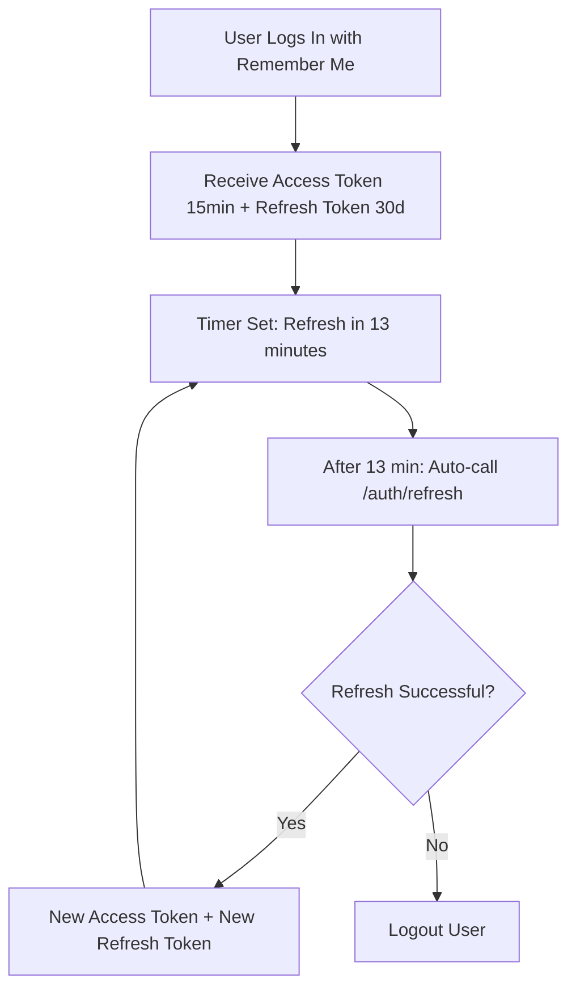

# Refresh Token Implementation - Walkthrough

## Overview
Implemented a comprehensive refresh token system that allows users with "Stay logged in" enabled to remain authenticated for up to 30 days with automatic, seamless session renewal.

---

## What Changed

### Before 🔴
- **Without "Remember Me"**: Users logged out after 60 minutes
- **With "Remember Me"**: Users logged out after 7 days
- No automatic token renewal
- Hard logout when JWT expires

### After ✅
- **Without "Remember Me"**: Users logged out after 15 minutes (no refresh token issued)
- **With "Remember Me"**: Users stay logged in for 30 days with automatic token renewal every ~13 minutes
- Seamless session extension
- Users never interrupted by forced logout (unless they close browser without Remember Me)

---

## Technical Implementation

### Token Lifespans

| Scenario | Access Token | Refresh Token | Session Duration |
|----------|--------------|---------------|------------------|
| **No "Remember Me"** | 15 min | Not issued | 15 minutes total |
| **With "Remember Me"** | 15 min | 30 days | 30 days (auto-renewed) |

### Automatic Refresh Flow



---

## Backend Changes

### 1. New Refresh Token Entity

**File**: [refresh-token.entity.ts](file:///home/thanos98/Develop/test-seo/scout-badges/backend/src/auth/entities/refresh-token.entity.ts)

Created database entity to store refresh tokens:
- Token string (unique, cryptographically secure)
- User relationship (with CASCADE delete)
- Expiration date
- Creation timestamp

**Database Table**: `refresh_tokens`

### 2. Updated Auth Module

**File**: [auth.module.ts](file:///home/thanos98/Develop/test-seo/scout-badges/backend/src/auth/auth.module.ts)

- Reduced access token lifetime: `60m` → `15m`
- Imported RefreshToken entity
- Added TypeORM repository for refresh token management

### 3. Enhanced Auth Service

**File**: [auth.service.ts](file:///home/thanos98/Develop/test-seo/scout-badges/backend/src/auth/auth.service.ts)

**New Methods**:
- `generateRefreshToken()`: Generates cryptographically secure 128-character token
- `refreshAccessToken()`: Validates refresh token, issues new access token, rotates refresh token
- `revokeRefreshToken()`: Removes refresh token from database
- `cleanupExpiredTokens()`: Utility to remove expired refresh tokens

**Updated Methods**:
-  `login()`: Now issues refresh token if `rememberMe` is true

**Key Security Feature**: **Token Rotation**
- Every refresh issues a NEW refresh token
- Old refresh token is immediately deleted
- Prevents token replay attacks

### 4. New API Endpoints

**File**: [auth.controller.ts](file:///home/thanos98/Develop/test-seo/scout-badges/backend/src/auth/auth.controller.ts)

#### `POST /auth/refresh`
- **Input**: `{ refresh_token: string }`
- **Output**: `{ access_token, expires_at, refresh_token, refresh_expires_at }`
- **Purpose**: Exchange refresh token for new access token

#### `POST /auth/logout`
- **Input**: `{ refresh_token: string }` (optional)
- **Output**: `{ message: "Logged out successfully" }`
- **Purpose**: Revoke refresh token server-side

---

## Frontend Changes

### 1. Enhanced Auth Store

**File**: [stores/auth.js](file:///home/thanos98/Develop/test-seo/scout-badges/frontend/src/stores/auth.js)

**New State Fields**:
```javascript
refreshToken: null         // 30-day refresh token (localStorage only)
refreshExpiresAt: null     // Refresh token expiration
refreshTimer: null         // Automatic refresh timer
```

**New Actions**:

#### `scheduleTokenRefresh()`
- Calculates time until 2 minutes before token expires
- Sets timeout to automatically call `refreshAccessToken()`
- Ensures tokens are always fresh

#### `refreshAccessToken()`
- Calls `/auth/refresh` endpoint
- Updates access token and refresh token (rotation)
- Re-schedules next refresh
- On failure: logs out user

#### `initializeRefreshTimer()`
- Called on app startup
- Restores automatic refresh for returning users

**Updated Actions**:
- `login()`: Stores refresh token and schedules first refresh
- `logout()`: Revokes refresh token server-side, clears timer
- `checkAuth()`: Automatically refreshes if token expired but refresh token available

### 2. App Initialization

**File**: [App.vue](file:///home/thanos98/Develop/test-seo/scout-badges/frontend/src/App.vue)

Added `onMounted` hook to initialize refresh timer when app starts:
```javascript
onMounted(() => {
  authStore.initializeRefreshTimer();
});
```

This ensures users who return to the app with a valid refresh token automatically resume their session.

---

## User Experience

### Scenario 1: User Without "Remember Me"
1. Login → Receive 15-min access token (no refresh token)
2. After 15 minutes → Access token expires
3. Next API call → 401 Unauthorized → Logged out → Redirected to login

**Result**: Same as before, just shorter session (15 min vs 60 min)

### Scenario 2: User With "Remember Me"
1. Login → Receive 15-min access token + 30-day refresh token
2. Timer scheduled for 13 minutes
3. After 13 minutes → Auto-refresh (invisible to user)
4. Receive new 15-min access token + new 30-day refresh token
5. Repeat every 13 minutes for up to 30 days
6. User can close browser and return anytime within 30 days

**Result**: Seamless experience, no forced logouts for 30 days

### Scenario 3: User Closes Browser Tab
- **Without Remember Me**: Logged out (sessionStorage cleared)
- **With Remember Me**: Still logged in when they return (localStorage persists)

---

## Security Features

✅ **Token Rotation**: Each refresh generates new refresh token, old one invalidated  
✅ **Cryptographically Secure**: Refresh tokens use `crypto.randomBytes(64)`  
✅ **Server-Side Storage**: Refresh tokens stored in database, can be revoked  
✅ **Short Access Tokens**: 15-min lifetime limits damage if compromised  
✅ **Automatic Cleanup**: Expired refresh tokens deleted from database  
✅ **CASCADE Delete**: Refresh tokens auto-deleted when user is deleted  

---

## Testing

### Manual Testing Steps

1. **Test Automatic Refresh (Remember Me ON)**
   ```bash
   # Login with Remember Me
   # Open browser DevTools → Network tab
   # Wait 13 minutes
   # Should see automatic POST to /auth/refresh
   # Verify new tokens in localStorage
   # Verify session continues without interruption
   ```

2. **Test Session Persistence**
   ```bash
   # Login with Remember Me
   # Close browser completely
   # Reopen browser, navigate to app
   # Should still be logged in
   # First API call should trigger token refresh if needed
   ```

3. **Test Without Remember Me**
   ```bash
   # Login WITHOUT Remember Me
   # Wait 15+ minutes
   # Make any navigation or API call
   # Should be logged out and redirected to login
   ```

4. **Test Logout**
```bash
   # Login with Remember Me
   # Click Logout
   # Check Network tab: POST to /auth/logout with refresh_token
   # Verify refresh token removed from database
   # Try to use old refresh token → Should fail with 401
   ```

5. **Test 30-Day Expiration**
   ```bash
   # Login with Remember Me
   # In database, manually set refresh_token.expiresAt to past date
   # Make API call
   # Should be logged out (refresh token expired)
   ```

---

## Database Migration

The new `refresh_tokens` table will be **automatically created** by TypeORM on first backend startup.

**Schema**:
```sql
CREATE TABLE refresh_tokens (
    id SERIAL PRIMARY KEY,
    token VARCHAR(255) UNIQUE NOT NULL,
    expiresAt TIMESTAMP NOT NULL,
    createdAt TIMESTAMP DEFAULT NOW(),
    userId INTEGER REFERENCES users(id) ON DELETE CASCADE
);
```

---

## Files Modified

### Backend
| File | Changes |
|------|---------|
| [auth.module.ts](file:///home/thanos98/Develop/test-seo/scout-badges/backend/src/auth/auth.module.ts) | 15min token expiration, import RefreshToken |
| [auth.service.ts](file:///home/thanos98/Develop/test-seo/scout-badges/backend/src/auth/auth.service.ts) | Refresh token generation, validation, rotation |
| [auth.controller.ts](file:///home/thanos98/Develop/test-seo/scout-badges/backend/src/auth/auth.controller.ts) | /auth/refresh and /auth/logout endpoints |

### Frontend
| File | Changes |
|------|---------|
| [stores/auth.js](file:///home/thanos98/Develop/test-seo/scout-badges/frontend/src/stores/auth.js) | Refresh token storage, auto-renewal timer |
| [App.vue](file:///home/thanos98/Develop/test-seo/scout-badges/frontend/src/App.vue) | Initialize refresh timer on mount |

### New Files
| File | Purpose |
|------|---------|
| [refresh-token.entity.ts](file:///home/thanos98/Develop/test-seo/scout-badges/backend/src/auth/entities/refresh-token.entity.ts) | Database entity for refresh tokens |

---

## Summary

✅ **Implemented**: Full refresh token system with automatic renewal  
✅ **Access Tokens**: 15 minutes (reduced from 60 min)  
✅ **Refresh Tokens**: 30 days for "Remember Me" users  
✅ **Auto-Refresh**: Happens 2 minutes before token expires  
✅ **Security**: Token rotation, server-side revocation, cascade deletion  
✅ **UX**: Seamless sessions, no forced logouts for 30 days  

Users with "Stay logged in" now have a truly persistent session that auto-renews transparently!
